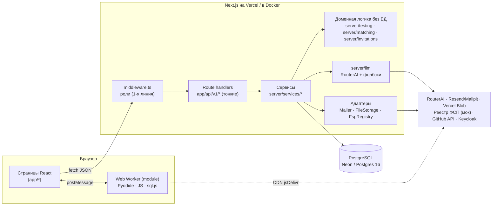
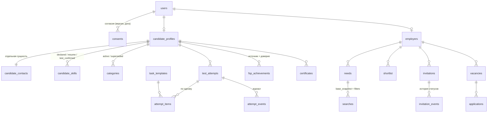

# Архитектура

Монолит на Next.js 15 (App Router) с явным разделением слоёв. Один деплой на Vercel, одна база PostgreSQL.

## Слои

| Слой | Где | Что делает | Чего не делает |
|---|---|---|---|
| UI | `app/`, `components/` | Серверные компоненты читают данные через сервисы, клиентские — через API | Не хранит эталонов, не решает доступ |
| Route handlers | `app/api/v1/**/route.ts` | Аутентификация (`server/http/guard.ts`), Zod-валидация (`parseJson`/`parseQuery`), маппинг ошибок в HTTP (`server/http/route.ts`) | Бизнес-логики нет: 5–15 строк на эндпоинт |
| Сервисы | `server/services/*` | Бизнес-правила, транзакции, проверка владельца, аудит, уведомления | Не знают про HTTP |
| Домен без БД | `server/testing`, `server/matching`, `server/invitations/fsm.ts`, `server/evidence` | IRT/CAT, генераторы заданий, проверка ответов, скоринг, конечный автомат, ловушки, калибровка | Чистые функции — тестируются и симулируются без базы |
| Данные | `server/db/schema.ts`, `drizzle/` | Схема Drizzle, миграции | — |
| Адаптеры | `server/mail`, `server/storage`, `server/fsp`, `server/llm` | Интерфейс + 2 реализации (локально / Vercel / мок) | — |

Права проверяются дважды: `middleware.ts` отсекает чужие разделы по роли из JWT, а сервисы перечитывают роль и статус пользователя из БД на каждом запросе (`requireActor`) и проверяют владельца ресурса. Чужие ресурсы возвращают 404 — так нельзя узнать, существует ли объект.

## Модель данных

Ключевые решения:

- **Контакты — отдельная таблица `candidate_contacts`.** Сериализатор работодателя (`toCard`, `candidateForEmployer`) не обращается к ней без проверки `hasContactAccess`. Каждое чтение и раскрытие контактов попадает в `audit_log`.
- **Подборка — неизменяемый снимок** (`searches.base_snapshot`): список id и скоров на момент поиска. Фильтры хранятся отдельно и применяются поверх снимка.
- **Генераторы заданий — код**, а метаданные шаблонов (IRT a/b, экспозиция, счётчики для детектора слива, статус) — строки `task_templates`. Синхронизация идёт через `syncTemplates()`, откалиброванные параметры не перетираются.
- **Эталоны не хранятся.** Вариант задания — детерминированная функция `(шаблон, seed задания)`, сервер пересчитывает эталон при проверке.
- **Периодические процессы без cron.** Протухание приглашений и попыток, а также «свежесть» профиля считаются лениво при чтении (ограничение бесплатного Vercel).

## Ограничения Vercel и как они учтены

| Ограничение | Решение |
|---|---|
| Нет фоновых воркеров | Всё короткими запросами; ленивое протухание; калибровка — CLI-скрипт |
| Таймаут функций | LLM: таймаут 20 с, `maxDuration = 30`, один вызов на запрос, кеш по хешу входа, детерминированный фолбэк |
| Нет файловой системы | `FileStorage`: Vercel Blob в проде, `./storage` локально; лимит загрузки 4 МБ |
| COOP/COEP для прерывания Pyodide | Заголовки только на `/test/*` и `/runner/*`; на страницу теста — полная навигация; module-воркер |
| Пул соединений | `postgres` с `prepare: false` (pgbouncer Neon), `max: 1` в serverless |
| In-memory rate limit — на инстанс | Upstash при наличии ключа; суточный лимит приглашений — в БД |
