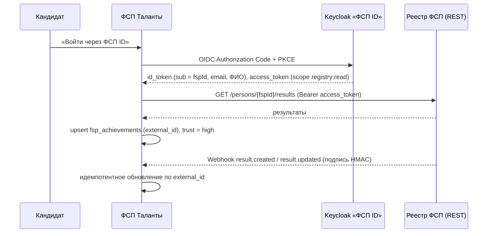

# Интеграция с ФСП: реестр и «ФСП ID»

API ФСП для кейса не предоставлен, поэтому платформа работает через интерфейсы. Реальную интеграцию можно подключить заменой реализаций, не трогая бизнес-логику.

## Что реализовано в прототипе

| Компонент | Файл | Статус |
|---|---|---|
| Интерфейс реестра `FspRegistry.lookup(fspId)` | `server/fsp/registry.ts` | готов |
| `MockFspRegistry` — детерминированный синтетический реестр | там же | готов |
| Привязка ФСП ID в профиле и импорт достижений (`source = fsp_registry`, `trust = high`) | `server/services/candidate.ts → linkFsp` | готов, покрыт тестами |
| Деградация при недоступности реестра (503, ранее импортированные данные сохраняются) | там же | готов |
| Вход через «ФСП ID» (OIDC через Keycloak), флаг `AUTH_KEYCLOAK_ENABLED` | `server/auth/index.ts`, `infra/keycloak/realm.json`, профиль `keycloak` в docker-compose | готов, по умолчанию выключен |

Поведение мока для демо:

- ID формата `FSP-123456`;
- окончание `000` — человека нет в реестре (404);
- окончание `999` — реестр недоступен (503);
- остальные ID — 1–5 достижений, детерминированных по ID.

## Модель данных реестра (как у ФСП)

```
Человек (fspId, ФИО, регион, спортивный разряд, рейтинг)
 └─ Соревнование (название, дисциплина: алгоритмическое | продуктовое | ИБ | робототехника | БАС)
     └─ Этап (региональный → окружной → финал, год)
         └─ Результат (место | позиция в рейтинге, команда)
```

### Маппинг полей

| Реестр ФСП | Платформа (`fsp_achievements`) |
|---|---|
| ID результата | `external_id` (уникален в паре с профилем — повторный импорт идемпотентен) |
| Соревнование | `competition` |
| Дисциплина | `discipline` |
| Этап | `stage` (`regional` / `district` / `final`) |
| Год | `year` |
| Место | `place` (null — участие без места) |
| Позиция в рейтинге | `rank` |
| Спортивный разряд | `sports_category` |
| Команда, рейтинг, регион | `evidence` (JSONB) |
| — | `source = fsp_registry`, `trust_level = high` |

## Уровни доверия к достижениям

| Источник | Как подтверждается | Вес в скоринге |
|---|---|---|
| `fsp_registry` | Импорт из реестра по ФСП ID | 1.0 |
| `organizer` | Сертификат организатора без сигналов риска в метаданных (PDF: Creator/Producer, даты, инкрементальные сохранения, подпись; изображения: EXIF) | 0.8 |
| `repo` | Репозиторий GitHub: кандидат среди авторов, коммиты в окне мероприятия, не форк | 0.6 |
| `self` | Заявлено кандидатом (или сертификат с сигналами риска) | 0.2 |

## Схема будущей реальной интеграции



1. **Аутентификация.** Провайдер Keycloak в Auth.js уже подключён. Для продакшена:
   - заменить `AUTH_KEYCLOAK_ISSUER` на реальный realm ФСП;
   - добавить claim `fsp_id` (в демо-realm он лежит в атрибутах пользователя) и сохранять его в `candidate_profiles.fsp_id` при первом входе.
2. **Чтение реестра.** Реализация `HttpFspRegistry implements FspRegistry`:
   - REST с токеном пользователя (scope `registry:read`) или сервисным токеном;
   - таймаут 5 с, ретрай с экспоненциальной задержкой, кеш ответа на 24 часа.
3. **Обновления.** Вебхуки реестра (`result.created`, `result.updated`, `person.merged`) на `/api/v1/integrations/fsp/webhook`:
   - проверка HMAC-подписи;
   - идемпотентность по `external_id`;
   - если вебхуки недоступны — ночная сверка или ленивое обновление при открытии профиля (без cron на бесплатном Vercel).
4. **Недоступность реестра.** Ранее импортированные достижения остаются и учитываются. Новая привязка возвращает 503 с понятным текстом. Достижения можно временно подтвердить сертификатом или репозиторием (доверие ниже), после восстановления реестра — переимпорт.
5. **Конфликты.** Один ФСП ID — один профиль (проверяется в `linkFsp`, ответ 409). Слияние персон в реестре обрабатывается по вебхуку `person.merged`.

## Keycloak локально

```bash
AUTH_KEYCLOAK_ENABLED=true docker compose --profile keycloak up -d
# realm "fsp" импортируется из infra/keycloak/realm.json
# пользователь: fsp-candidate / Demo12345, клиент fsp-talents
```

При входе через OIDC пользователь создаётся с ролью «кандидат» и подтверждённым email (`upsertOidcUser`). Согласия на обработку ПДн собираются при первом визите в кабинет.

> Проверено юнит-логикой и сборкой. Полный OIDC-обмен с поднятым Keycloak в среде разработки прототипа запустить не удалось (Docker Hub ограничивал загрузку образов), поэтому профиль `keycloak` стоит проверить локально.
