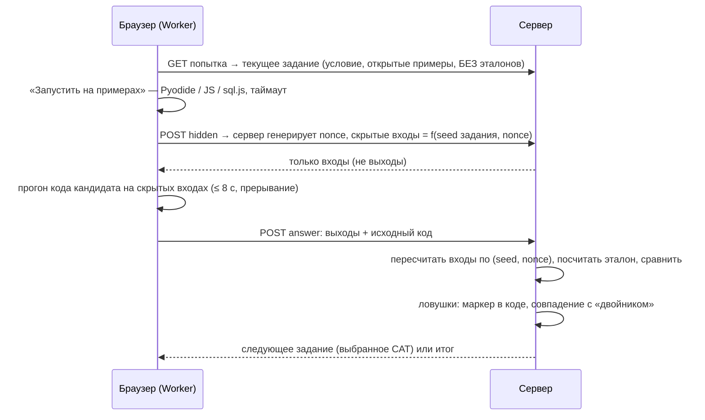

# Механика тестирования и почему её не сольют

## Коротко

1. Кандидат **сам выбирает грейд** и проходит адаптивный тест на него: 10–18 заданий, не больше 60 минут, задания выдаются **по одному сервером**.
2. Задания — **параметризованные шаблоны** с откалиброванной сложностью (IRT 2PL), а не фиксированный список вопросов. Каждый вариант уникален для попытки.
3. Код кандидата запускается **у него в браузере**: Pyodide, JS, sql.js. Но итоговая проверка идёт по **скрытым входам, сгенерированным в момент отправки**. Эталон считает только сервер.
4. По итогу присваивается **категория** «специализация · грейд». Без неё кандидата нет в подборках.
5. Попытку сопровождают **журнал и ловушки для ИИ**, из них складывается **индекс доверия**. Автоматических банов нет.

## Банк шаблонов

| Специализация | Шаблонов | code | sql | calc | quiz |
|---|---|---|---|---|---|
| Backend | 27 | 11 (Python/JS) | 6 | 5 | 5 |
| Frontend | 26 | 11 (JS) | — | 8 | 7 |
| Data / ML | 26 | 10 (Python) | 5 | 6 | 5 |
| QA | 25 | 8 (Python/JS) | 4 | 7 | 6 |

Шаблон — это TypeScript-модуль (`server/testing/bank/<spec>/*.ts`). По `seed` он выдаёт:

- параметры (числа, константы условия, наборы данных);
- текст условия из блоков (абзацы, код, таблицы);
- открытые примеры с ответами;
- генератор **скрытых входов** (отдельный поток RNG `seed/hidden/nonce`);
- серверный решатель `solve` и **эталонные решения** на Python/JS.

Юнит-тесты (`tests/unit/bank.test.ts`, 411 проверок) для каждого шаблона и пяти seed проверяют:

- детерминизм и разнообразие вариантов;
- что эталонные решения на JS (в Node) и на Python (`python3`) дают ровно то же, что серверный `solve`, на открытых и скрытых входах;
- что эталонный ответ принимается, а неверный — нет;
- что ловушки срабатывают.

Ограничения банка: концептуальных вопросов (quiz) в банке меньше 30%, они выдаются не чаще 30% на любом префиксе теста и весят меньше (вес правдоподобия 0.6). Сложность `b` распределена от −2.2 до +2.3.

## Адаптивный тест (CAT)

- **Модель**: 2PL, P(верно | θ) = 1 / (1 + e^(−a(θ − b))).
- **Оценка θ**: EAP на сетке [−4, 4], априорное N(θ_старт/2, 1.25²). Выбор грейда — информативный, но не доминирующий. Частичный балл за код (доля пройденных скрытых тестов) входит в правдоподобие как дробный ответ.
- **Выбор задания**: максимум информации Фишера в текущей θ с поправками:
  - баланс типов (доля типа в банке), запрет трёх одинаковых типов подряд;
  - quiz ≤ 30% на каждом префиксе, вес quiz понижен;
  - **контроль экспозиции**: штраф для часто выдаваемых шаблонов и случайный выбор из top-5 (randomesque).
- **Остановка**: не раньше 10 заданий; затем при SE < 0.42 или когда решение очевидно (|θ − cut| ≥ 2·SE); максимум 18 заданий; серверный дедлайн 60 минут.
- **Балл /30**: ожидаемое число верных ответов на виртуальном эталонном бланке грейда из 30 заданий (true-score equating). Порог грейда θ = cut даёт 18/30, «уверенно» — от 25/30. Так результаты разных адаптивных попыток сопоставимы.
- **Пороги** (`server/config.ts`): cut_junior = −0.9, cut_middle = 0.2, cut_senior = 1.3.

### Правила пересдачи (`server/testing/eligibility.ts`, покрыты тестами)

| Ситуация | Правило |
|---|---|
| Первая попытка в специализации | Любой грейд |
| Тот же грейд | Не чаще раза в 14 дней |
| Грейд ниже уже пробованного | Сразу (понижение не принудительное) |
| Грейд выше всех пробованных | Только при результате ≥ 25/30 на грейде ниже |

Провал не снимает существующую категорию. Новая категория заменяет старую той же специализации, только если её грейд не ниже.

## Проверка кода: «подделать можно, только решив задачу»

- Скрытые входы появляются только после нажатия «Отправить», живут 120 секунд, на каждую отправку генерируется новый nonce.
- Для SQL сервер сам выполняет эталонный запрос на сгенерированных данных через тот же sql.js.
- Код сохраняется для антиплагиата и перепроверки модератором.
- Python прерывается через interrupt-буфер (SharedArrayBuffer при COOP/COEP) без перезагрузки Pyodide. JS и SQL при таймауте пересоздают воркер.

**Честное ограничение.** Скорость и память в браузере не проверяются, а код технически можно выполнить и вне браузера. Но верные выходы на свежих скрытых входах получит только тот, кто решил задачу. Для задач с лимитами времени и памяти план — серверная песочница (Judge0/Piston на VPS), интерфейс проверки к этому готов.

## Почему банк не сольют

| Угроза | Защита |
|---|---|
| Ответы публикуют в Telegram | Слив варианта бесполезен: числа, данные и константы меняются по seed, скрытые входы — по nonce в момент отправки |
| Сливают сам шаблон (идею задачи) | Адаптивность и контроль экспозиции растягивают использование банка; **онлайн-детектор дрейфа**: если доля верных ответов на шаблоне выше прогноза IRT на ≥ 15 п. п. при z ≥ 3, шаблон получает `flagged` и не учитывается в θ. В симуляции слива 20% шаблонов детектор нашёл все 5 слитых без ложных срабатываний, ложный «сдал на грейд выше» упал с 40.8% до 15.1% (см. `validation.md`) |
| Генерация заданий ИИ «на лету» несопоставима | Генераторы — проверенный код; сложность откалибрована; балл приведён к эталонному бланку |
| Решение за кандидата пишет ИИ | Ловушки и индекс доверия (ниже), сравнение решений между кандидатами |
| Перебор ответов | Ответ на задание принимается один раз; пересдача — по правилам выше |

## Антифрод: журнал, ловушки, индекс доверия

Журнал (`attempt_events`):

- уходы со вкладки и потеря фокуса;
- выход из полноэкранного режима: тест идёт только в полноэкранном режиме, при выходе контент закрывается;
- попытки копирования условия: копирование запрещено, попытка пишется;
- вставки в редактор (только длина, без содержимого) и крупные вставки (≥ 200 символов);
- время на задание.

Ловушки (уникальны для попытки, `server/testing/engine.ts` + `components/test/statement.tsx`):

1. **Персональный маркер** — слово вида `kvant_x9d` на попытку.
2. **Скрытый текст** в условии (font-size 0, `aria-hidden`) с инструкцией ИИ-ассистенту назвать переменную маркером. Попадает в DOM, в буфер при обходе запрета копирования и к расширениям, читающим страницу.
3. **Микротекст** той же инструкции почти фоновым цветом внутри декоративной линии — против фото и скриншотов.
4. **Значение-двойник**: на экране одно число (через CSS `::before`), в DOM-тексте другое. Решение, посчитанное по скопированному тексту, совпадает с «невозможным» вариантом. Сервер проверяет это, пересчитывая эталон с подставленным двойником. Для экранных дикторов доступно видимое значение (`role="img"` + `aria-label`).

**Индекс доверия** = 100 − Σ сигналов: маркер в коде (−65), двойник (−40), крупные вставки, уходы со вкладки, выходы из полноэкранного режима, попытки копирования, аномально быстрые верные ответы на сложных заданиях, person-fit lz (Drasgow).

| Уровень | Что происходит |
|---|---|
| high ≥ 70 | Категория присваивается |
| medium 40–69 | Категория присваивается с пометкой (видна работодателю, снижает вклад теста в скоринг) |
| low < 40 | Категория не присваивается; попытка уходит модератору, кандидату предложена перепроверка |

Модератор (`/admin`) видит журнал, сработавшие ловушки, код и похожие решения других кандидатов: нормализованные токены, 5-граммы, Жаккар ≥ 0.8. Он подтверждает результат (категория с пометкой) или отклоняет. Кандидат предупреждён о журнале до начала теста (152-ФЗ, прозрачность).

## Калибровка

- Стартовые a, b — экспертные.
- На каждый ответ копятся `answered`, `correct`, `expected` (Σ P(верно) при θ до ответа) — для детектора дрейфа.
- `npm run calibrate` переоценивает a, b логистической регрессией по оценкам θ (`server/testing/calibration.ts`). Берёт реальные ответы, если их ≥ 30 на шаблон, иначе синтетику. Откалиброванные параметры не перетираются синхронизацией шаблонов.
- В валидации калибровка снижает RMSE параметра b с 0.47 до 0.19 на симулированных данных.

## Что показала валидация (см. `validation.md`)

- Тест-ретест на разных вариантах: корреляция θ 0.81, совпадение решения «сдал / не сдал» ~79%.
- Итоговая категория совпала с истинным уровнем у ~76% кандидатов, ошибки — на одну ступень у границ грейдов. Категорию выше истинной получили ~7%.
- Точность ограничена информативностью банка (26 шаблонов на специализацию): CAT почти всегда использует максимум заданий. Рост банка и калибровка на реальных ответах — главный рычаг повышения точности.
