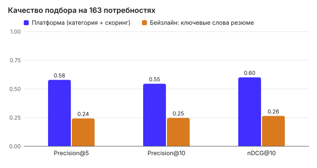
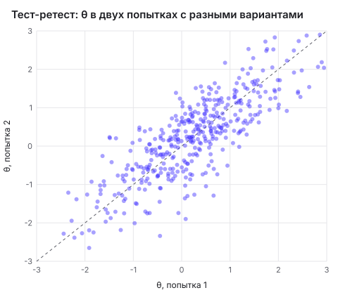
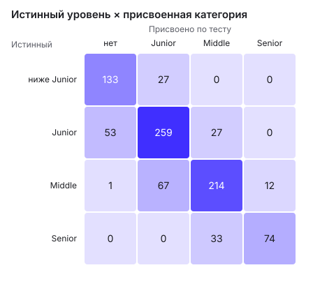
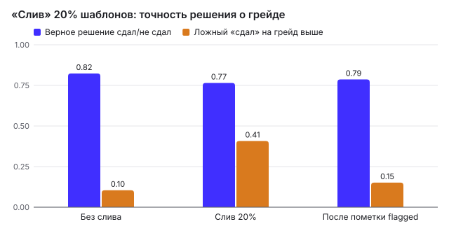
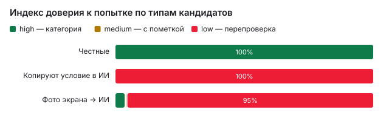
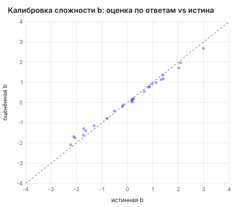

# Валидация подбора и тестирования

Отчёт сгенерирован командой `npm run validate` (2026-10-06), все числа воспроизводимы: генераторы синтетики и симуляций детерминированы (seedrandom). Данные — синтетические, со «скрытой истиной» (истинная способность θ, истинный грейд, реальные навыки, минимально приемлемая зарплата), которая известна только валидатору и никак не используется продуктом.

## 1. Качество подбора

Популяция: 700 кандидатов, 179 потребностей (163 с хотя бы одним релевантным кандидатом). Разметка «релевантен / нет» — правилами по скрытой истине: та же специализация, **истинный** грейд равен грейду потребности, кандидат реально владеет ≥ 50% стека, его минимальные ожидания ≤ 110% верхней границы вилки, формат совместим.

| Метод | Precision@5 | Precision@10 | nDCG@10 |
|---|---|---|---|
| **Платформа**: жёсткий фильтр по категории из теста + скоринг | **0.58** | **0.55** | **0.60** |
| Платформа без бонуса ФСП (абляция) | 0.60 | 0.54 | 0.60 |
| Бейзлайн: совпадение ключевых слов резюме | 0.24 | 0.25 | 0.26 |



Главный источник выигрыша — фильтр по категории из теста: самоописание (резюме) не содержит надёжной информации о грейде, ~30% кандидатов в синтетике завышают его, а заявленные навыки содержат «приписки». Бонус ФСП в синтетике коррелирует с истинной θ, поэтому абляция без него немного хуже.

### Выборка для ручной проверки

Лучший и худший кандидат подборки для нескольких потребностей — с доводами, которые видит работодатель. Ручная проверка подтверждает, что доводы соответствуют компонентам скоринга и не содержат фактов вне профиля.

| Потребность | Match | Релевантен по истине | Доводы «за» | Доводы «против» |
|---|---|---|---|---|
| Разработчик интерфейсов (Junior), javascript, typescript, redux, react, webpack | 65 | да | Уверенно сдал тест Junior: 26.0/30; JavaScript и TypeScript подтверждены тестом; Ожидания 120 000 ₽ — в пределах вилки; Заявлен опыт: Redux, React и Webpack / Vite (не проверено тестом) | Предпочитает формат «Удалённо»; Другой город: Москва |
| Разработчик интерфейсов (Junior), javascript, typescript, redux, react, webpack | 42 | нет | JavaScript и TypeScript подтверждены тестом; Тест Junior сдан: 19.1/30; Ожидания 80 000 ₽ — в пределах вилки; Участие в соревнованиях ФСП: 2 подтверждённых результатов | Нет данных о навыках: Redux, React и Webpack / Vite; Предпочитает формат «Удалённо» |
| React-разработчик (Junior), javascript, typescript, html, nodejs, graphql | 67 | да | Уверенно сдал тест Junior: 26.4/30; JavaScript и TypeScript подтверждены тестом; Node.js — косвенно подтверждено тестом; Готов к формату «Гибрид» | Нет данных о навыках: HTML; Другой город: Москва |
| React-разработчик (Junior), javascript, typescript, html, nodejs, graphql | 45 | да | JavaScript и TypeScript подтверждены тестом; Тест Junior сдан: 18.3/30; Ожидания 140 000 ₽ — в пределах вилки; Node.js — косвенно подтверждено тестом | Нет данных о навыках: HTML и GraphQL; Предпочитает формат «Удалённо» |
| Разработчик микросервисов (Junior), java, kubernetes, mysql | 77 | да | Уверенно сдал тест Junior: 27.3/30; Java подтверждён тестом; Ожидания 80 000 ₽ — в пределах вилки; MySQL — косвенно подтверждено тестом | Достижений ФСП немного |
| Разработчик микросервисов (Junior), java, kubernetes, mysql | 38 | нет | Тест Junior сдан: 19.4/30; MySQL — косвенно подтверждено тестом | Нет данных о навыках: Java и Kubernetes; Ожидания 160 000 ₽ — выше вилки на 14% |
| Тестировщик (Junior), testdesign, postman, selenium, linux, python, pytest | 72 | да | Уверенно сдал тест Junior: 25.8/30; Тест-дизайн, Postman и Python подтверждены тестом; Ожидания 130 000 ₽ — в пределах вилки; Призёр ФСП: 2 место, Всероссийский хакатон ФСП (региональный этап, 2025) | Достижений ФСП немного |
| Тестировщик (Junior), testdesign, postman, selenium, linux, python, pytest | 45 | нет | Тест-дизайн, Postman и Python подтверждены тестом; Тест Junior сдан: 18.9/30; Ожидания 80 000 ₽ — в пределах вилки; pytest — косвенно подтверждено тестом | Нет данных о навыках: Selenium и Linux; Предпочитает формат «Удалённо» |
| Разработчик интерфейсов (Junior), javascript, typescript, nodejs, jest | 71 | да | Уверенно сдал тест Junior: 25.7/30; JavaScript и TypeScript подтверждены тестом; Ожидания 80 000 ₽ — в пределах вилки; Node.js — косвенно подтверждено тестом | Истории в ФСП нет |
| Разработчик интерфейсов (Junior), javascript, typescript, nodejs, jest | 51 | да | JavaScript и TypeScript подтверждены тестом; Тест Junior сдан: 19.6/30; Ожидания 130 000 ₽ — в пределах вилки; Node.js — косвенно подтверждено тестом | Нет данных о навыках: Jest; Предпочитает формат «Офис» |
| Backend-разработчик (Junior), python, rest, microservices | 72 | нет | Уверенно сдал тест Junior: 26.7/30; Python подтверждён тестом; Заявлен опыт: REST API и Микросервисы (не проверено тестом); Ожидания 80 000 ₽ — в пределах вилки | Достижений ФСП немного |
| Backend-разработчик (Junior), python, rest, microservices | 36 | нет | Python подтверждён тестом; Тест Junior сдан: 18.8/30 | Нет данных о навыках: REST API и Микросервисы; Ожидания 170 000 ₽ — выше вилки на 13% |

## 2. Надёжность теста (тест-ретест)

400 симулированных кандидатов (θ ~ N(0.1, 1.05)) дважды проходят адаптивный тест своего истинного грейда на банке Backend. Варианты заданий разные (другой seed попытки → другие параметры, данные и порядок отбора из top-K).

| Показатель | Значение |
|---|---|
| Корреляция θ между попытками | **0.81** |
| Корреляция оценки θ с истинной θ | 0.90 |
| Совпадение решения «сдал / не сдал» | **78.5%** |
| Совпадение итога (уверенно / сдал / не сдал) | 62.7% |
| Средняя длина теста | 17.1 заданий (мин. 10, макс. 18) |



## 3. Различающая способность: присвоение грейда

900 кандидатов: 70% выбирают свой истинный грейд, остальные ошибаются на ступень (чаще — вверх). Дальше они действуют по правилам пересдачи: после провала — сразу грейд ниже, после уверенного результата (≥ 25/30) — сразу грейд выше. Категория = наивысший сданный грейд.

| Показатель | Значение |
|---|---|
| Итог совпал с истинным уровнем (включая «нет категории» для θ ниже порога Junior) | **75.6%** |
| Ошибка на одну ступень | 24.3% |
| Категория выше истинного грейда (самое дорогое для работодателя) | 7.3% |
| Среднее число попыток на кандидата | 1.37 |
| Средняя длина попытки (CAT) | 16.8 заданий |
| Причины остановки | максимум заданий: 81.6%; решение очевидно (|θ − cut| ≥ 2.5·SE): 18.4% |



Строки — истинный уровень (θ ниже порога Junior — категория не положена), столбцы — присвоенная категория («нет» — ни один тест не сдан). Ошибки сосредоточены у границ грейдов: кандидат с θ рядом с порогом с вероятностью ~50% окажется по любую сторону — это свойство любой процедуры с порогами, а не адаптивности.

## 4. Устойчивость к утечке заданий

Симулируем «слив» 5 из 27 шаблонов Backend (20%): на слитых заданиях кандидат отвечает верно с вероятностью 0.95 независимо от способности. Это худший случай: утёк сам шаблон, а не отдельный вариант (варианты параметризованы, и слив одного варианта почти не помогает). Половина когорты пробует грейд выше своего истинного — там слив опаснее всего.

| Сценарий | Верное решение «сдал / не сдал» | Ложный «сдал» при попытке грейда выше | Смещение θ | RMSE θ |
|---|---|---|---|---|
| Без слива | 82.3% | 10.4% | -0.00 | 0.44 |
| Слив 20% шаблонов | 76.5% | 40.8% | 0.47 | 0.72 |
| После калибровки: слитые помечены flagged и сняты с оценки | 78.7% | 15.1% | 0.02 | 0.48 |

Детектор дрейфа (доля верных выше прогноза IRT на ≥ 15 п.п. при z ≥ 3 и ≥ 30 ответах) пометил **5** шаблонов, из них слитых — **5 из 5** (полнота 100.0%, точность 100.0%). На чистых данных ложных пометок: 0.



## 5. Ловушки и индекс доверия

По 500 симулированных попыток каждого типа. Индекс доверия — 100 минус сумма сигналов (маркер, двойник, вставки, уходы со вкладки, выход из полноэкранного режима, быстрые верные ответы на сложных заданиях, person-fit); уровни: high ≥ 70, medium 40–69, low < 40.

| Тип | high (категория) | medium (с пометкой) | low (перепроверка, без категории) |
|---|---|---|---|
| Честные | 100.0% | 0.0% | 0.0% |
| Копируют условие в ИИ | 0.0% | 0.0% | 100.0% |
| Фото экрана → ИИ | 4.0% | 0.6% | 95.4% |



**Допущения симуляции (честно):** ассистент, получивший скрытую инструкцию, использует маркер в 60% кодовых заданий; при копировании DOM-текста значение-двойник попадает в расчёт в 90% случаев; по фото экрана микротекст считывается и исполняется в 25% случаев. Реальные доли нужно измерить на пилоте — индекс настраивается весами в `server/testing/trust.ts`. Ложные срабатывания на честных — это доля честных с уровнем low; автоматических блокировок нет в любом случае.

## 6. Калибровка параметров заданий

Стартовые параметры IRT (a, b) — экспертные. Чтобы проверить процедуру калибровки (`npm run calibrate`), задаём «истинные» параметры, отличающиеся от экспертных (шум σ_b = 0.45, σ_a = 0.25), симулируем 3000 прохождений и оцениваем a, b логистической регрессией по оценкам θ.

| Показатель | Значение |
|---|---|
| RMSE экспертной b относительно истинной | 0.47 |
| RMSE откалиброванной b | **0.19** |
| Корреляция откалиброванной и истинной b | 1.00 |



В проде калибровка идёт на реальных ответах: счётчики `answered/correct/expected` копятся по каждому шаблону, детектор утечки срабатывает онлайн, а пересчёт a, b выполняется периодически тем же кодом (`server/testing/calibration.ts`).

## Как воспроизвести

```bash
npm run validate   # пишет docs/validation.md и docs/img/*.svg
```

Время прогона на ноутбуке: ~35 с.
